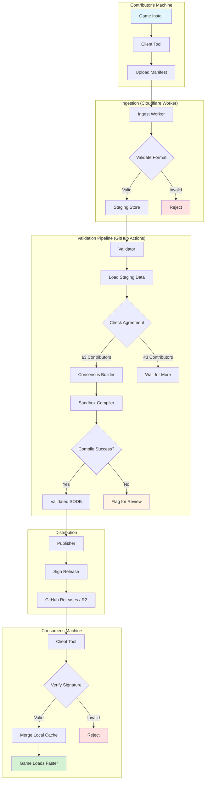

# open-shader-db Architecture

This document describes the technical architecture, data model, and trust model for open-shader-db.

**Last updated:** October 24, 2026  
**Status:** Early design – subject to change

## Table of contents

- [Overview](#overview)
- [System components](#system-components)
- [Data model and strong types](#data-model-and-strong-types)
- [Upload flow](#upload-flow)
- [Trust and anti-poisoning model](#trust-and-anti-poisoning-model)
- [Privacy model](#privacy-model)
- [Signing and release flow](#signing-and-release-flow)
- [Failure modes and mitigations](#failure-modes-and-mitigations)
- [Open questions](#open-questions)
- [References](#references)

## Overview

open-shader-db is a distributed system for collecting, validating, and distributing pipeline state records to help reduce compilation stuttering in Direct3D 12 games. The system is designed around three core principles:

1. **Privacy first:** No accounts, no IP logging, no game paths
2. **Anti-poisoning:** Multi-contributor agreement, proof of ownership
3. **Free hosting:** Static file distribution via GitHub Releases or Cloudflare R2

### What we publish

Microsoft's State Object Database (SODB) is a SQLite database (`user_version=2`, `application_id=0xD3D50DB`) containing:
- **Pipeline state descriptions:** Root signatures, blend descriptors, rasterizer state, depth/stencil state, input layouts, render target formats, etc.
- **DXIL shader bytecode:** Compiled shader code (copyrighted by game publishers)

**Our approach:** We publish **pipeline state records WITHOUT shader bytecode**, keyed by shader content hash plus game build. These records contain only the state descriptors, root signatures, and format configurations. The client rebuilds complete SODBs locally by:
1. Extracting shader bytecode from the user's installed game files
2. Matching them by content hash to our published records
3. Combining state descriptors + user's shaders
4. Compiling locally into a functional SODB

**Milestone plan** (names match GitHub exactly):
- **M0 Index and coverage reports** (ships first): foundations plus index-only verification
- **M1 Pipeline-state records:** full state records (without bytecode) + client rebuild (needs legal clarity first)
- **M2 Upload preview and submission:** client preview/submit plus Cloudflare ingest Worker
- **M3 Consensus and publishing:** threshold, proof-of-ownership checks, review queue
- **M4 Signed releases:** Minisign, GitHub Releases, client verification
- **M5 Windows validation:** deferred Windows + GPU compile validation

### High-level architecture



## System components

### 1. Client tool (local executable)

**Purpose:** Scan games, generate upload manifests, download and merge databases

**Key responsibilities:**
- Discover installed games from known patterns (no manual path entry)
- Read and analyze local SODB files
- Generate anonymized upload manifests with description hashes
- Show upload preview before transmission
- Download latest validated indexes
- Verify release signatures
- Help users understand shader cache coverage

**Implementation notes:**
- Runs entirely locally – no network calls except explicit upload/download
- Upload preview UI shows exactly what will be sent
- Platform: Windows (C++, Rust, or C# – TBD)

**Type sketch:**
```typescript
interface ClientTool {
  scanGames(): GameInstall[]
  analyzeSODB(sodbPath: string): UploadManifest
  previewUpload(manifest: UploadManifest): UploadPreview
  submitUpload(manifest: UploadManifest): UploadResult
  downloadIndex(gameId: GameId): IndexBundle
  verifySignature(bundle: IndexBundle): boolean
  compareWithIndex(localSODB: string, index: ConsensusIndex): CoverageReport
}
```

### 2. Ingest Worker (Cloudflare Worker)

**Purpose:** Receive uploads, validate format, store in staging

**Key responsibilities:**
- Accept HTTP POST with upload manifest
- Validate JSON schema and hash formats
- Check hashes against shipped game lists (anti-poisoning)
- Write to staging store (Cloudflare R2 or GitHub PR)
- Return upload receipt (no contributor tracking)

**Implementation notes:**
- Stateless: no sessions, no cookies
- Rate limiting via Cloudflare's built-in rules (temporary, not stored)
- Turnstile challenge for bot detection (ephemeral, not persistent)
- Per-build upload cap (limit uploads per BuildId)

**Type sketch:**
```typescript
interface IngestWorker {
  handleUpload(manifest: UploadManifest): UploadReceipt | Error
  validateSchema(manifest: unknown): manifest is UploadManifest
  checkHashList(hashes: ShaderHash[], gameId: GameId): boolean
  writeToStaging(manifest: UploadManifest): void
}
```

### 3. Validation pipeline (standalone service or manual review)

**Purpose:** Build consensus, validate data, publish safe indexes

**Key responsibilities:**
- Load all staging manifests for a given game build
- Group by build ID and description hash
- Count uploads per description hash (consensus threshold TBD)
- Detect Sybil attacks via proof-of-ownership verification
- Flag anomalies for human review
- Publish validated indexes

**Implementation notes:**
- Runs on a schedule (e.g., daily) or on-demand
- Each game build is validated independently
- Manual review fallback for edge cases
- Publishes validated indexes (not SODBs)

**Validation approach (approved):** Skip automated compile-validation for M0 through M4. Rely on proof of ownership, upload threshold, and manual review via GitHub PRs. Windows + GPU compile validation is **M5 Windows validation** (deferred).

**Type sketch:**
```typescript
interface ValidationPipeline {
  loadStagingData(gameId: GameId, buildId: BuildId): UploadManifest[]
  buildConsensus(manifests: UploadManifest[]): ConsensusIndex
  detectAnomalies(manifests: UploadManifest[]): Anomaly[]
  publishValidated(index: ConsensusIndex): void
  flagForReview(reason: string, manifests: UploadManifest[]): void
}
```

### 4. Publisher (release automation)

**Purpose:** Sign and distribute validated indexes

**Key responsibilities:**
- Sign validated indexes/records with Minisign
- Generate checksums (SHA256)
- Upload to GitHub Releases or Cloudflare R2
- Generate download manifest (JSON index of available releases)

**Implementation notes:**
- Signing: Minisign with offline project key (no personal identifiers)
- Considered but not chosen: Sigstore (keyless/transparency log approach)
- Immutable releases: never modify, only add new versions
- Signatures provide integrity; hosting platforms do not guarantee it

**Type sketch:**
```typescript
interface Publisher {
  signRelease(data: CoverageIndex | PipelineStateRecord[]): Signature
  generateChecksums(data: any): Checksums
  uploadToRelease(data: any, sig: Signature): ReleaseURL
  generateManifest(releases: Release[]): DownloadManifest
}
```

### 5. Static distribution (GitHub Releases or Cloudflare R2)

**Purpose:** Host indexes for download

**Key responsibilities:**
- Serve signed index files
- Serve checksums and signatures
- Serve download manifest (JSON catalog)

**Implementation notes:**
- Immutable: files are never modified
- CDN-backed for performance
- No authentication required
- Integrity verified by signatures, not hosting platform

## Data model and strong types

### Understanding SODB format

An SODB is a SQLite database (see [State Object Database specification](https://microsoft.github.io/DirectX-Specs/d3d/StateObjectDatabase.html#sql-database-schema)) with:
- `PRAGMA user_version = 2`
- `PRAGMA application_id = 0xD3D50DB`
- Key tables:
  - `pipeline_states` – PSO entries with state descriptors + references to shader bytecode
  - `state_objects` – State object entries (raytracing, work graphs)
  - `shader_bytecode` – DXIL bytecode blobs (COPYRIGHTED, cannot redistribute)
  - `root_signatures` – Root signature descriptors
  - `*_descs` tables – State descriptors (blend, rasterizer, depth/stencil, etc.)

**What a pipeline_states row contains (verified from spec):**
- `Key` – Application-defined binary key (not a content hash)
- `RootSignature` – Foreign key to root_signatures table
- `InputLayout` – Foreign key to input layout descriptors
- `ByteCode_VS`, `ByteCode_PS`, `ByteCode_HS`, `ByteCode_DS`, `ByteCode_GS`, `ByteCode_AS`, `ByteCode_MS`, `ByteCode_CS` – Foreign keys to shader_bytecode table (COPYRIGHTED)
- `DepthStencilDesc`, `BlendDesc`, `RasterizerDesc` – Foreign keys to state descriptor tables
- `RenderTargetFormats`, `ViewInstancingDesc`, `StreamOutDesc` – Foreign keys to format/descriptor tables
- `SampleDesc_Count`, `SampleDesc_Quality`, `SampleMask`, `IBStripCutValue`, `PrimitiveTopology`, `DSVFormat`, `NodeMask`, `Flags` – Direct integer/enum values

**Separable components (state descriptors only, no bytecode):**
- Root signature descriptors (resource binding layouts)
- Blend descriptors (blend modes, write masks, logic ops)
- Rasterizer descriptors (fill mode, cull mode, depth bias, etc.)
- Depth/stencil descriptors (depth test, stencil ops, etc.)
- Input layouts (vertex buffer formats, semantics)
- Render target formats (pixel formats for each RT)
- View instancing descriptors
- Stream output descriptors
- Sample descriptors (MSAA settings)
- Various flags and enums

These are configuration data (integers, enums, booleans) that describe "how to configure the GPU" – not executable code.

**Copyright constraint:** The DXIL bytecode in `shader_bytecode` table is compiled from publisher shaders and is copyrighted. We cannot redistribute it.

**What we publish:** Pipeline state records containing only the separable state descriptors, keyed by shader content hash (SHA256 of DXIL bytecode). The client matches these to shaders extracted from the user's installed game files.

### BuildId

Uniquely identifies a game build.

```typescript
interface BuildId {
  gameId: string          // e.g., "cyberpunk2077"
  version: string         // e.g., "2.13.0"
  exeHash: string         // SHA256 of game .exe for verification
}
```

### M0 Index and coverage reports: index-only types

These types support verifying local SODBs against community consensus without publishing full state records.

```typescript
interface DescriptionHash {
  type: "pipeline_state" | "state_object"
  descHash: string        // SHA256 of serialized state descriptors (no bytecode)
  bytecodeHashes: string[] // SHA256 of each DXIL blob
  appKeyHex: string       // App-defined key from SODB (hex)
  version: number         // Version field from SODB
}

interface CoverageIndex {
  buildId: BuildId
  descriptions: DescriptionHash[]
  uploadCount: number
  consensusCount: number
  generatedAt: string     // ISO 8601
}
```

### M1 Pipeline-state records (without bytecode)

These types support publishing full state records that clients combine with locally extracted shaders. Legal review is required before implementation.

```typescript
// Verified from SODB spec: these are direct fields from pipeline_states table
interface PipelineStateRecord {
  // Keyed by shader content hashes
  bytecodeHashes: {
    vs?: string           // SHA256 of vertex shader DXIL
    ps?: string           // SHA256 of pixel shader DXIL
    hs?: string           // Hull shader
    ds?: string           // Domain shader
    gs?: string           // Geometry shader
    as?: string           // Amplification shader
    ms?: string           // Mesh shader
    cs?: string           // Compute shader
  }
  
  // State descriptors (integers, enums, booleans - separable from bytecode)
  rootSignature: string   // Serialized root signature descriptor
  inputLayout: InputElementDesc[] | null
  depthStencil: DepthStencilDesc | null
  blendDesc: BlendDesc | null
  rasterizerDesc: RasterizerDesc | null
  renderTargetFormats: RenderTargetFormats | null
  viewInstancingDesc: ViewInstancingDesc | null
  streamOutDesc: StreamOutDesc | null
  sampleDesc: { count: number; quality: number } | null
  sampleMask: number | null
  ibStripCutValue: number | null
  primitiveTopology: number | null
  dsvFormat: number | null
  nodeMask: number | null
  flags: number | null
  
  // Metadata
  appKeyHex: string       // App-defined key from game's SODB
  version: number         // Version from SODB groups table
  buildId: BuildId
}

// Note: The actual D3D12 descriptor structures (DepthStencilDesc, BlendDesc, etc.)
// are complex and will be defined based on the D3D12 API specification.
// See: https://learn.microsoft.com/en-us/windows/win32/direct3d12/
```

### Unverified / To Be Determined

The following aspects require further research or testing:

- **Shader extraction:** How to reliably extract DXIL bytecode from installed game files (format varies by engine)
- **Matching mechanism:** Whether bytecode hash alone is sufficient, or if additional metadata (entry points, shader models) is needed
- **Root signature format:** Whether serialized root signatures can be shared or must be reconstructed from descriptors

### UploadManifest

The anonymized data sent by contributors.

```typescript
interface UploadManifest {
  version: "1.0.0"        // Schema version
  buildId: BuildId
  descriptions: DescriptionHash[]
  shaderRefs: ShaderReference[]
  timestampHour: string   // ISO 8601 rounded to hour
  clientVersion: string   // open-shader-db client version
  proofOfOwnership: string // Challenge response proving exe access
  // NO: user ID, IP, game path, machine ID, full timestamp
}
```

### AgreementThreshold

The consensus requirement for a description hash to be included.

```typescript
interface AgreementThreshold {
  minUploads: number       // Minimum uploads reporting same descHash
  minAgreementRatio: number // Minimum ratio of agreeing uploads
}

// Without accounts, "independent contributors" cannot be enforced.
// Agreement is on full description hash plus bytecode hash.
// Sybil resistance: proof of exe ownership, Cloudflare rate limiting + Turnstile,
// per-build upload cap, manual review fallback via GitHub PRs.
```

### ConsensusIndex

A verified index of shader descriptions built from consensus.

```typescript
interface ConsensusIndex {
  buildId: BuildId
  descriptions: DescriptionHash[]
  shaderRefs: ShaderReference[]
  uploadCount: number      // Total uploads analyzed
  consensusCount: number   // Descriptions meeting threshold
  rejectedCount: number    // Descriptions not meeting threshold
  generatedAt: string      // ISO 8601
}
```

### ValidationResult

The outcome of validation (currently unspecified; see Open Questions).

```typescript
interface ValidationResult {
  success: boolean
  buildId: BuildId
  validatedAt: string      // ISO 8601
  method: string           // Validation approach TBD
  errors: string[]
  warnings: string[]
}

// Open question: How do we validate without access to Windows + GPU + 
// vendor compiler? Compiling SODB to PSDB requires those components.
// Possible approaches: Windows sandbox/VM, AppContainer, manual review only.
```

### IndexBundle

A signed, downloadable index release.

```typescript
interface DataBundle {
  buildId: BuildId
  dataFile: URL            // Download URL (JSON)
  signature: string        // Minisign signature (.minisig)
  checksums: {
    sha256: string
  }
  size: number             // Bytes
  publishedAt: string      // ISO 8601
  dataType: "coverage_index" | "pipeline_records"
}
```

## Upload flow

1. **User runs client:** `open-shader-db scan`
2. **Client discovers games:** Checks known install locations (Steam, Epic, etc.)
3. **Client reads local SODB:** Parses SQLite database, extracts description hashes
4. **Client generates proof:** Challenge-response proving exe ownership
5. **Client shows preview:** GUI displays what will be uploaded (no personal data)
6. **User approves:** Explicitly confirms upload
7. **Client POSTs manifest:** Sends JSON to ingest worker (HTTPS)
8. **Worker validates:** Checks schema, proof of ownership
9. **Worker stores:** Writes to staging (R2 or GitHub PR)
10. **Client receives receipt:** Confirmation (no tracking ID)

**Privacy guarantees:**
- Worker logs omit IP addresses (configure Cloudflare Logpush accordingly)
- No game paths in manifest
- No machine identifiers
- Timestamp rounded to hour
- Rate limiting via Cloudflare edge (temporary, not stored); Turnstile (ephemeral)

## Trust and anti-poisoning model

### Threat: Malicious uploads

**Attack:** A bad actor uploads invalid or fabricated description hashes to poison the index.

**Mitigations:**
1. **Proof of ownership:** Challenge-response requiring access to game exe (e.g., sign a nonce with a hash derived from exe)
2. **Multi-upload consensus:** Require multiple uploads reporting the same description hash
3. **Agreement on full content:** Consensus is on hash of complete description plus bytecode hash, not just app keys
4. **Manual review fallback:** Anomalies flagged for human review
5. **Signed releases:** Clients verify signatures before using indexes

### Threat: Data poisoning via Sybil attack

**Attack:** A bad actor submits multiple uploads from fake identities to meet consensus threshold.

**Mitigations (honest assessment):**
1. **No accounts = no enforcement:** Without accounts, we cannot enforce "independent contributors"
2. **Proof of ownership:** Must prove access to the specific game build (harder to fake without owning it)
3. **Rate limiting:** Cloudflare's built-in rate limiting (temporary, at edge, not stored) plus Turnstile challenge (ephemeral bot detection)
4. **Per-build upload cap:** Limit total uploads accepted per BuildId
5. **Statistical analysis:** Flag suspicious patterns (e.g., many uploads in short window, identical timing)
6. **Manual review fallback:** GitHub PR submission as trust anchor for initial releases
7. **Community verification:** Users can compare published indexes against their local SODBs

### Threat: Supply chain attack (compromised client)

**Attack:** Attacker distributes modified client that uploads bad data.

**Mitigations:**
1. **Signed releases:** Official client binaries are signed (Minisign initially; Windows Authenticode later)
2. **Open source:** Community can audit and build from source
3. **Reproducible builds:** Independent verification of official binaries

### Threat: Compromised distribution

**Attack:** Attacker modifies databases on distribution server.

**Mitigations:**
1. **Immutable releases:** Files are never modified after publishing
2. **Signed databases:** Clients verify signatures before use
3. **Checksums:** SHA256 hashes prevent corruption or tampering
4. **CDN integrity:** GitHub Releases and Cloudflare R2 provide integrity guarantees

## Privacy model

### What we collect

- Game identifier (e.g., "cyberpunk2077")
- Game version and exe hash
- Description hashes (non-personal technical data)
- Shader bytecode hashes (non-personal technical data)
- Timestamp rounded to hour
- Client version
- Proof of ownership (challenge response)

### What we DO NOT collect

- User accounts or authentication
- Email addresses
- Machine identifiers (CPU ID, MAC address, hardware fingerprints)
- Game installation paths
- Operating system user names
- Full timestamps (rounded to hour)

### IP address handling

- **Cloudflare Worker logs:** Configure Logpush to omit `ClientIP` field
- **Rate limiting:** Handled by Cloudflare at edge (temporary in-memory, not persisted to storage)
- **Turnstile:** Bot detection at edge (ephemeral, no persistent fingerprinting)
- **No correlation:** IP not stored with uploads

### Data retention

- **Staging data:** Retained until validated or 90 days (whichever is sooner)
- **Published indexes:** Retained indefinitely (immutable releases)
- **Worker logs:** Configured with no ClientIP field; retained per Cloudflare retention policy

### Legal considerations

- **GDPR:** Description hashes are not personal data; IP handling must comply if EU users contribute
- **CCPA:** No personal information collected
- **No tracking:** No cookies, no analytics, no persistent fingerprinting

## Signing and release flow

1. **Validation pipeline completes:** CoverageIndex or PipelineStateRecords validated
2. **Publisher generates data file:** JSON file ready for distribution
3. **Publisher signs file:** Minisign signature created with offline project key
4. **Publisher generates checksums:** SHA256 hash computed
5. **Publisher uploads to GitHub Releases or R2:**
   - `cyberpunk2077-v2.13.0-build-abc123-coverage.json` (M0 Index and coverage reports)
   - `cyberpunk2077-v2.13.0-build-abc123-records.json` (M1 Pipeline-state records)
   - `*.minisig` – Minisign signature file
   - `*.sha256` – SHA256 checksum file
6. **Publisher updates download manifest:** JSON catalog of all releases
7. **Client downloads manifest:** Discovers available data
8. **Client verifies signature:** Checks Minisign signature
9. **Client verifies checksum:** Confirms SHA256 match
10. **M0 Index and coverage reports:** Client compares with local SODB and shows a coverage report
11. **M1 Pipeline-state records:** Client combines published records + local shaders and rebuilds an SODB

**Signing key management:**
- **Approved:** Minisign with dedicated project key (no personal identifiers)
- **Considered:** Sigstore (keyless transparency log approach) – not chosen for simplicity
- **Storage:** Offline backup, GitHub Actions secret for automation
- **Key rotation:** New key announced 30 days in advance, old key kept for verification
- **Not using initially:** Personal GPG keys with UIDs, Windows Authenticode (later milestone)

## Failure modes and mitigations

| Failure mode | Impact | Mitigation |
|--------------|--------|------------|
| **Too few uploads** | No index published for a game | Community outreach, client makes contributing easy |
| **Low agreement** | Consensus not reached | Flag for human review, wait for more data |
| **Validation uncertain** | Cannot confirm data integrity | Manual review, conservative thresholds |
| **Signing key compromised** | Malicious indexes distributed | Revoke key, reissue all releases with new key |
| **GitHub/R2 downtime** | Downloads unavailable | Mirror on both platforms, clients retry |
| **Sybil attack** | Bad data meets threshold | Proof of ownership, Cloudflare rate limiting + Turnstile, per-build cap, manual review fallback |
| **Client bug uploads bad data** | Staging polluted | Expire staging data after 90 days, version client |
| **Game update changes content** | Old index no longer matches | Client auto-detects version via exe hash, downloads new index |

## Open questions

### Fundamental questions for owner

1. **What does this project actually publish?** SODB files contain copyrighted shader bytecode we cannot redistribute. Options:
   - Content-hash indexes (description hashes + bytecode hashes) ← Current proposal
   - Verified mappings between app keys and content hashes
   - Tooling only (no data distribution)
   - Something else?

2. **How do we validate without redistributing bytecode?** Compiling SODB→PSDB needs Windows + GPU + vendor compiler. Options:
   - Windows sandbox/VM with GPU pass-through (expensive, complex)
   - AppContainer isolation on Windows (still needs GPU)
   - Manual review only initially
   - Skip compilation validation, rely on consensus only

3. **What can SODB consumers do with an index?** If we publish description hashes but not bytecode:
   - Users can verify their local SODB matches community consensus
   - Users cannot build an SODB from our data alone
   - Games still need to ship SODBs or generate them
   - Our value: verification, coverage reporting, trust signal

### Consensus and validation

4. **What upload count threshold?** Without enforced independence, how many uploads = trusted?
5. **Proof of ownership mechanism?** Challenge-response with exe hash? Something else?
6. **Manual review process?** GitHub PRs? Dedicated review queue?

### Distribution and performance

7. **GitHub Releases or Cloudflare R2?** Or both for redundancy?
8. **Index file size?** JSON compression? Binary format?

### Security and trust

9. **Rate limiting configuration?** What Cloudflare rate limit rules? What Turnstile sensitivity? What per-build upload cap?
10. **Should we publish validation logs?** Transparency vs. info disclosure
11. **Milestone timing?** When to start M1 Pipeline-state records versus staying with M0 Index and coverage reports?

## Legal and ToS doubts

**⚠️ IMPORTANT:** The following legal questions remain unresolved and require expert legal review before implementation.

### 1. Are pipeline state descriptors copyrightable?

**Question:** Are the state descriptor configurations (blend modes, rasterizer settings, depth/stencil ops, etc.) considered copyrightable creative expression, or are they functional/factual data?

**Doubt:** Copyright law protects creative expression but not functional specifications or facts. State descriptors are configuration integers and enums that describe GPU settings. However:
- Could a specific *combination* of state descriptors be considered creative?
- Do game publishers have a claim to the "creative choices" in how they configure the graphics pipeline?

**Similar precedents:**
- API specifications are generally not copyrightable (Oracle v. Google)
- Configuration files are often considered functional
- But game assets (even data files) are typically copyrighted

**Recommendation:** Seek legal counsel. Conservative approach: obtain explicit permission or wait for legal clarity.

### 2. Does extracting shaders from installed game files violate EULAs?

**Question:** Can users legally extract DXIL bytecode from their own installed game files for local recompilation?

**Doubt:** Most game EULAs prohibit:
- Reverse engineering
- Extracting game assets
- Modifying game files
- Creating derivative works

However:
- Is extracting *for personal performance optimization* covered under fair use?
- Does Advanced Shader Delivery imply permission for shader extraction (since it's meant to optimize performance)?
- Do users have the right to analyze files they legally own?

**Potential EULA violations:**
- Steam Subscriber Agreement § 2.C: "You may not... reverse engineer... any software"
- Epic Games Store EULA § 3: "You may not... reverse engineer... the Software"
- Most publisher EULAs have similar clauses

**Recommendation:** Seek legal counsel. May require explicit publisher permission or reliance on an untested fair use argument.

### 3. Does local extraction conflict with ASD storefront expectations?

**Question:** Does Microsoft's Advanced Shader Delivery framework expect/require that SODB files come from the publisher/storefront, not from community sources?

**Doubt:**
- ASD is designed for storefronts (Steam, Epic, Xbox, Microsoft Store) to compile and deliver PSDBs
- The workflow is: Game → SODB → Storefront → Compiled PSDB → User
- Our approach bypasses the storefront: Game → Extract shaders → Community records → User compiles locally

**Potential conflicts:**
- May violate implicit trust model (storefronts are trusted; community sources are not)
- May conflict with Microsoft's security/anti-cheat expectations
- May undermine storefront relationships with publishers

**Recommendation:** Seek clarification from Microsoft. May require explicit approval or a different approach.

### 4. Does publishing state descriptors constitute "distributing game assets"?

**Question:** Even without shader bytecode, are we "distributing game assets" by publishing state descriptors?

**Doubt:**
- State descriptors are extracted from the game's SODB file
- They represent the game developer's specific GPU configuration choices
- Publishers may argue this constitutes unauthorized distribution of proprietary data

**Counter-arguments:**
- State descriptors are functional data, not creative content
- They're derived from the user's legally owned copy
- Similar to publishing game configuration files or settings

**Recommendation:** Seek legal counsel. Consider requesting publisher permission for specific titles.

### 5. Does this approach comply with anti-cheat systems?

**Question:** Will extracting shader bytecode and rebuilding SODBs trigger anti-cheat systems or be considered cheating?

**Doubt:**
- Anti-cheat systems monitor file modifications and unexpected processes
- Extracting game files and recompiling shaders could be flagged as suspicious
- Modified SODBs could be seen as tampering with game files

**Recommendation:** Test with anti-cheat vendors and game publishers. May require explicit allowlisting or a different technical approach.

### Suggested path forward

1. **Consult legal counsel** specializing in software/gaming law
2. **Request Microsoft clarification** on ASD community participation
3. **Approach willing publishers** for pilot programs with explicit permission
4. **Consider alternative designs:**
   - Publisher-blessed distribution only
   - Storefront integration instead of community distribution
   - Stay on M0 Index and coverage reports without distributing state records (defer M1 Pipeline-state records)

**Until legal clarity:** Proceed cautiously. M0 Index and coverage reports has lower legal risk than M1 Pipeline-state records.

---

## References

### Microsoft documentation

- [Advanced Shader Delivery overview](https://learn.microsoft.com/en-us/windows/win32/direct3d12/advanced-shader-delivery)
- [State Object Database specification](https://microsoft.github.io/DirectX-Specs/d3d/StateObjectDatabase.html)
- [DirectX Graphics Samples - Advanced Shader Delivery](https://github.com/microsoft/DirectX-Graphics-Samples/tree/master/Samples/Desktop/D3D12AdvancedShaderDelivery)

### Related projects

- [SCSKiller](https://github.com/BlueHeisenberg/SCSKiller) – GPL-3.0-or-later shader compilation stutter mitigation tool

### Technical background

- [D3D12 State Object Database API](https://microsoft.github.io/DirectX-Specs/d3d/StateObjectDatabase.html#d3d12-state-object-database-api)
- [SQL Database Schema for SODB](https://microsoft.github.io/DirectX-Specs/d3d/StateObjectDatabase.html#sql-database-schema)

---

**Author:** Simsalabim  
**Last updated:** October 24, 2026  
**Status:** Early design – feedback welcome
